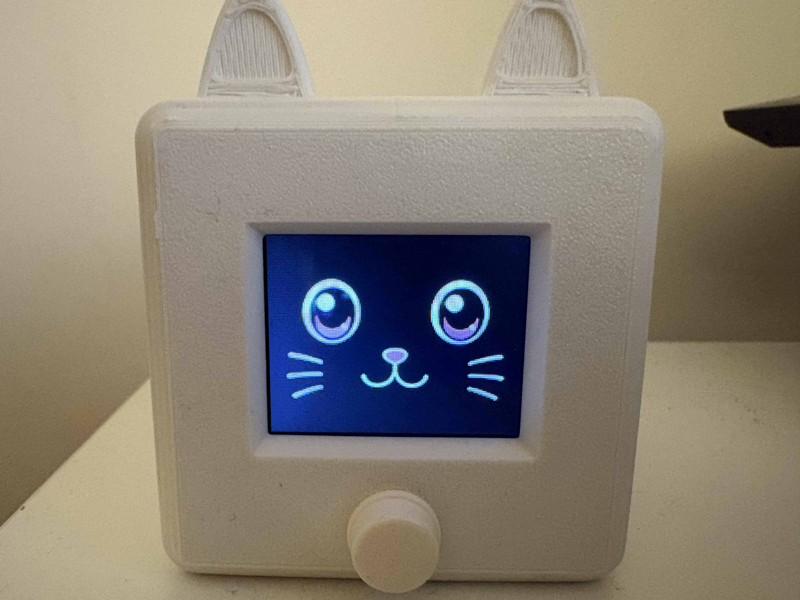
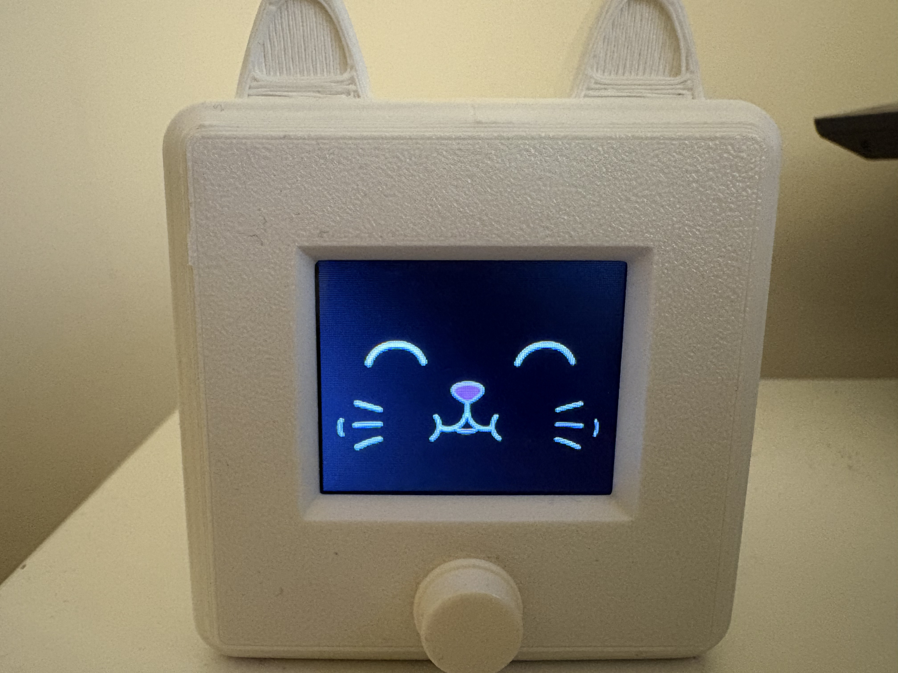
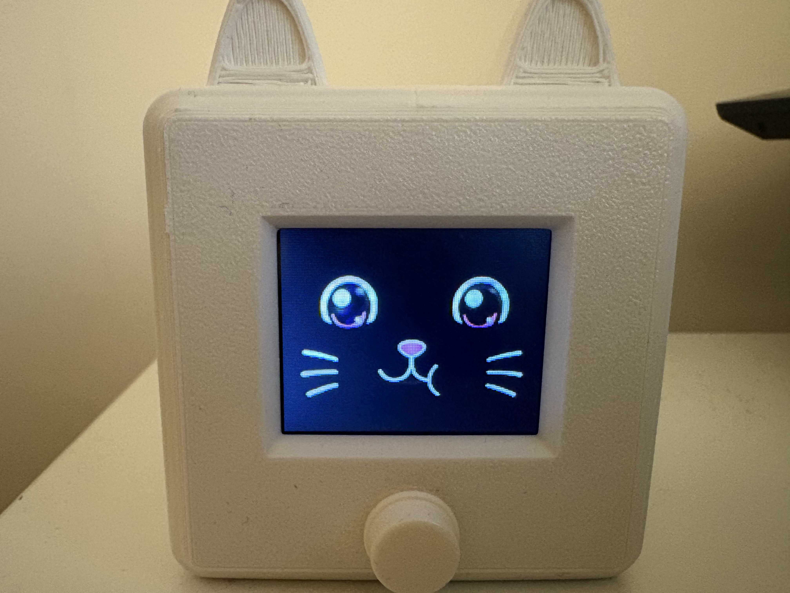
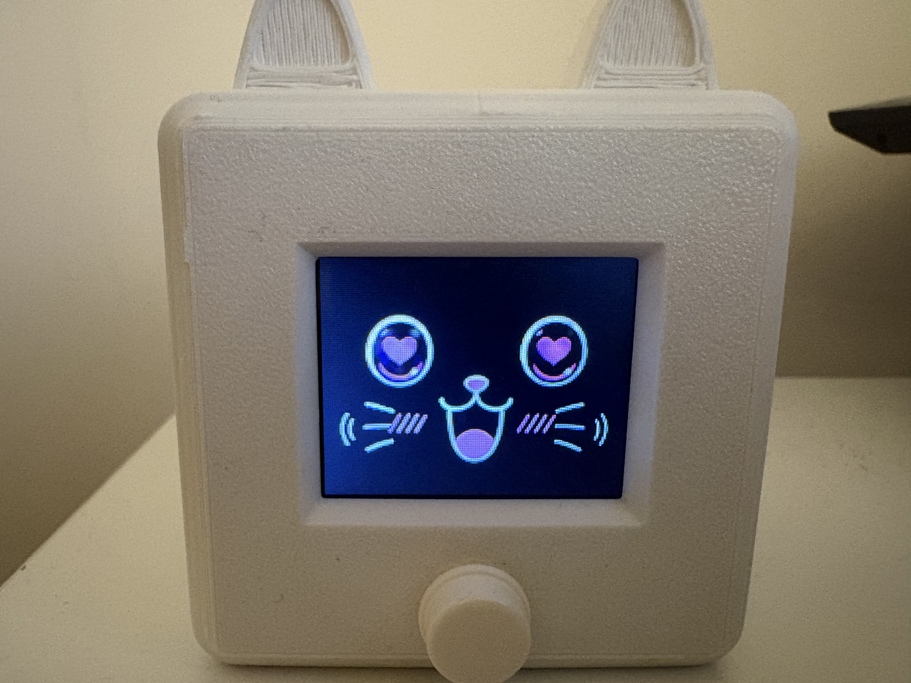
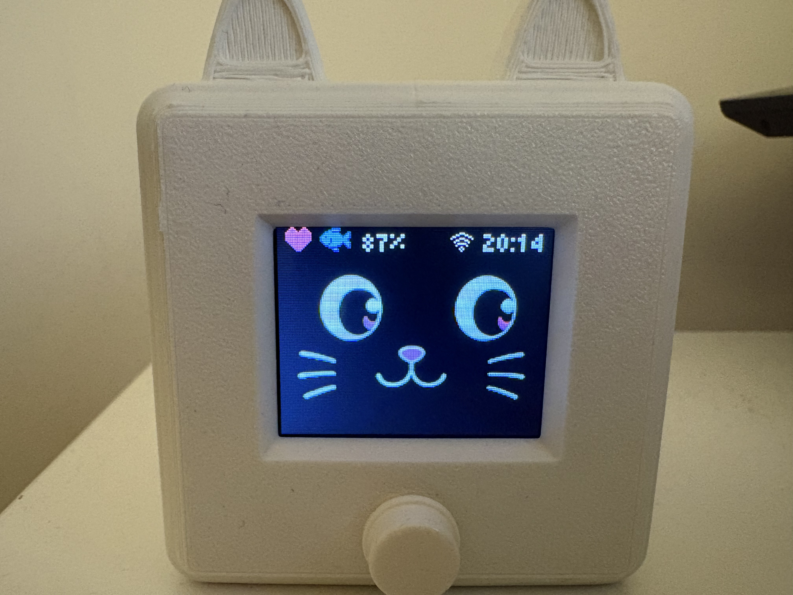
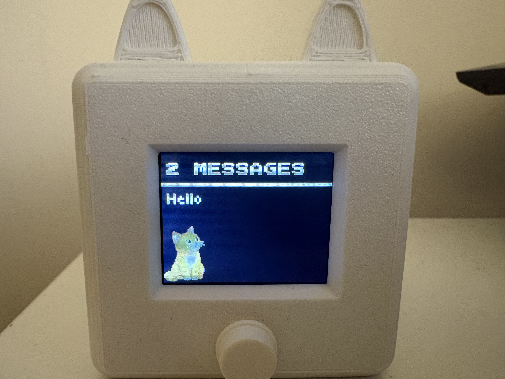
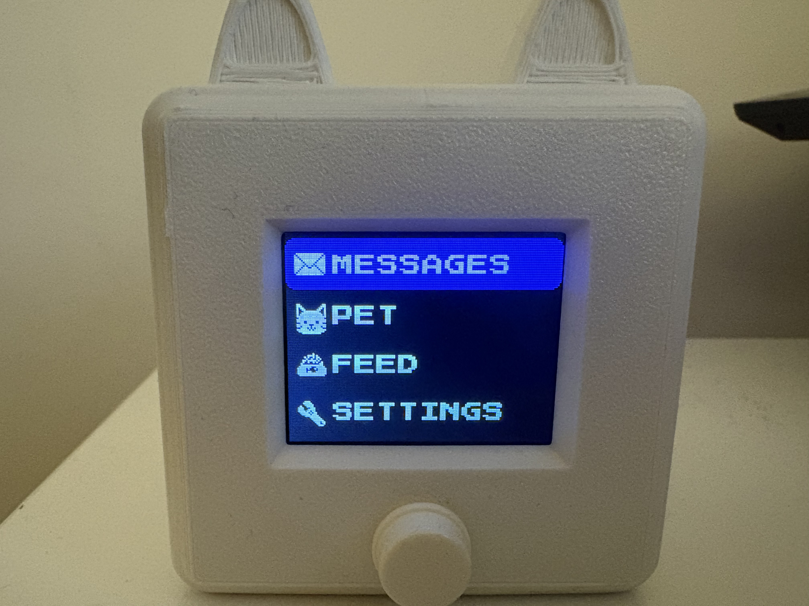
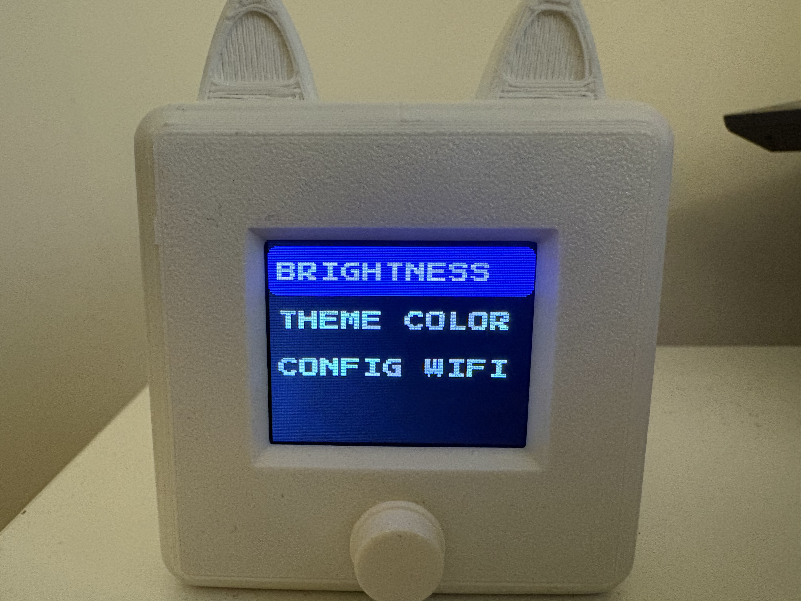

# esp32-message-pet

An interactive virtual pet powered by ESP32 that can receive Telegram messages.

<p align="center">
  
</p>

## Features

- Telegram message notifications and reading
- Virtual pet with hunger and happiness stats
- Animation system
- Single-button control
- Battery monitoring
- Automatic Deep sleep mode for reduced power consumption
- Persistent settings storage 
- Wi-Fi connectivity
- Custom TFT interface
- Fully customizable pixel-art graphics
- Sprite assets stored as raw C tables, with a conversion tool for importing custom graphics

## Hardware Required

- ESP32-WROOM-32U
- Waveshare 1.8" ST7735S TFT LCD (128 × 160)
- MAX17048 battery fuel gauge
- LiPo battery
- Tactile push button

Optional components (code does not depent on it):
- LiPo Amigo Pro battery charger
- TPS61023 step-up converter 

Default pin connections:
- GPIO25 - Main button
- GPIO19- TFT Screen MISO
- GPIO23 - TFT Screen MOSI
- GPIO18 - TFT Screen CLK
- GPIO05 - TFT Screen CS
- GPIO22 - TFT Screen DC
- GPIO21 - TFT Screen RST
- GPIO04 - TFT Screen BCKL
- GPIO16 - MAX17048 I2C SDA
- GPIO17 - MAX17048 I2C SCL

## Dependencies
- ESP-IDF 5.3.5

## Installation
1. Clone the repository
2. Create secrets.h with your secrets

```c
#ifndef SECRETS_H
#define SECRETS_H

#define BOT_TOKEN "BotToken"
#define WIFI_SSID "WifiSSID"
#define WIFI_PASSWORD "WifiPassword"
#define CHAT_ID 12345

#endif
```
3. Build and flash!


## Architecture 

The application is built with ESP-IDF and FreeRTOS. Separate tasks handle Telegram communication and user input, while the main application loop manages the application state machine and virtual pet behavior.

## Gallery

<div align="center">
  
  
  
  
  
  
  
  
</div>

## Author

Cezary Naworski - cezary.naworski98@gmail.com